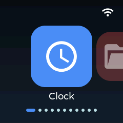
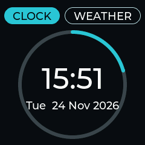
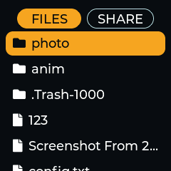
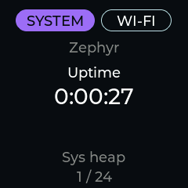
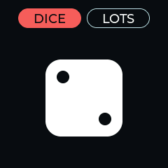
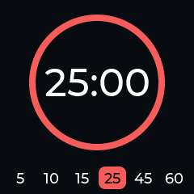
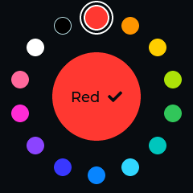
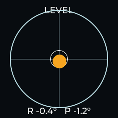
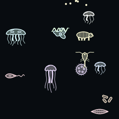

# ZephyrHoloCubic

English | [繁體中文](README.zh-TW.md)

A HoloCubic-style desk gadget built on Zephyr RTOS and LVGL: an ESP32 drives a 240x240 ST7789 screen viewed through a beam-splitter prism on top, plus an SD card, an MPU6050 motion sensor and one WS2812 RGB LED.

You control it with shell commands over the USB serial port, or by tapping the cube.

The code is the reference; this document only covers what is hard to see from the code. Each module's usage is in the comment at the top of `app/include/*.h`, the shell's `help` lists the commands, and `just` lists the build recipes.

## Apps

After boot you get the Menu, a horizontal carousel.

<table>
<tr>
<td align="center"><br>Menu</td>
<td align="center"><br>Clock</td>
<td align="center"><br>Files</td>
</tr>
<tr>
<td align="center"><br>System</td>
<td align="center"><br>Dice</td>
<td align="center"><br>Timer</td>
</tr>
<tr>
<td align="center"><br>Light</td>
<td align="center"><br>Level</td>
<td align="center"><br>Aquarium</td>
</tr>
</table>

The screenshots are the raw screen; through the prism it looks darker and softer. Take new ones with `just shot`.

| App | What it does |
|---|---|
| Clock | Network-synced clock; the WEATHER tab shows the current weather and today's high / low (wttr.in) |
| Files | The FILES tab browses the SD card (select a file to see its size); the SHARE tab is a web file manager |
| Gallery | PHOTOS tab: photos in `/photo/`, with an optional slideshow; ANIM tab: plays the JPEG sequences in `/anim/<name>/` |
| Level | Spirit level |
| Dice | A die, and drawing lots from `/lots.txt` |
| Light | Uses the RGB LED as a mood light |
| Timer | Countdown timer; turn the cube face down to pause |
| System | SYSTEM tab: heap, SD card, stack usage of every thread; WI-FI tab: signal strength, IP, nearby networks. One item at a time, up / down to move |
| Cast | Shows images, GIFs or your screen from a computer on the cube |
| Aquarium | Jellyfish and microbes; tap or OK to feed them |
| Test | An empty app for trying out new features |

## Hardware

| Part | Bus | Pins |
|---|---|---|
| ESP32 (PICO-D4, no PSRAM) | | Board: `esp32_devkitc/esp32/procpu` |
| ST7789V 240x240 screen | SPI3 (DMA) | SCLK 18, MOSI 23, DC 2, RST 4, backlight 5 (active low, on / off only) |
| SD card | SPI2 | SCLK 14, MOSI 13, MISO 26, CS 15 |
| MPU6050 | I2C0, 0x68 | SDA 32, SCL 33 |
| WS2812 RGB LED | I2S0 | DATA 27 |

Pins are defined in [app/boards/esp32_devkitc_procpu.overlay](app/boards/esp32_devkitc_procpu.overlay).

## Build and flash

Builds run in the dev container (`.devcontainer/`, Podman), so the host only needs Podman and VS Code (or the `devcontainer` CLI):

- The image is Zephyr's `zephyr-build`, with the Zephyr SDK (1.0.1), west, just and the Python packages the host tools use.
- The first start sets up the west workspace from [west.yml](west.yml): Zephyr (pinned revision, 4.5 development), hal_espressif and the Wi-Fi blobs. It lives in a named volume, so rebuilding the container keeps it.
- The host's `/dev` is mounted at `/host/dev`, so the board can be plugged in or replugged while the container runs. The port is the CP2102's fixed `/dev/serial/by-id/...` path (ttyUSB numbers change on replug, and other USB serial devices may be plugged in); it is used for flashing, the monitor and the tests.

```bash
just            # list all recipes
just build      # build
just flash      # flash
just monitor    # serial console (Ctrl+] to quit)
just test       # reset, open and close every app, report errors and stack usage
just test-share # test the Files app's SHARE tab on the device (needs Wi-Fi)
just shot clock.png "app open Clock"   # save the screen as a PNG; the rest are commands sent first
```

Flashing and the tests use the serial port, so close the monitor first. Use another port with `just port=/host/dev/ttyUSB0 flash`.

## Usage

Type commands in `just monitor`; `help` lists them all. The common ones:

```
app list / app open Gallery / app close
ui next / ui prev / ui ok / ui back / ui tap
ui up / ui down / ui left / ui right    when an app does not use a direction, up / left act as prev, down / right as next
ui remote             remote mode: arrow keys or wasd, Enter, e (tap), q (back), Ctrl+C to quit
wlan set SSID [PSK]   set up Wi-Fi and connect
wlan status / wlan scan / wlan forget
config list           all settings
```

Every app follows the same rules: **up / down to choose, left / right to switch tabs, OK to confirm, tap for the main action** (roll the die, feed the fish, start the timer, change the light, next photo…). The cube itself can only be tapped; everything else needs the serial port. Tapping does nothing in the Menu; in an app that does not handle it, a tap is `ui next`.

## Settings

Settings live in flash: they work without an SD card and survive reflashing.

| Key | Meaning | When unset |
|---|---|---|
| `wifi_ssid` | Wi-Fi network name (2.4 GHz only) | No network |
| `wifi_psk` | Wi-Fi password, 8 to 64 characters | Treated as an open network |
| `tz` | Time zone, e.g. `+8`, `-5`, `+5:30` | `+8` |
| `ntp_server` | NTP server for the clock | `pool.ntp.org` |
| `weather_location` | City name or `latitude,longitude` | Guessed from your IP |

Two ways to change them:

- **Shell**: `config set tz +9`, `config unset tz`; for Wi-Fi use `wlan set`. Takes effect immediately.
- **`/config.txt` on the SD card**, one `key=value` per line, edited on a computer or uploaded with Share. This file is only for **importing**: at boot, and when Share saves it, recognised keys are stored in flash and removed from the file, so it ends up empty and no password stays on the card. Malformed lines stay in the file with a warning in the log.

To make the cube forget the network, use `wlan forget` — do this before giving the cube to someone else.

## SD card

Format the SD card as FAT32.

```
/photo/*.jpg            Gallery's photos
/anim/<name>/000.jpg…   one folder per animation, numbered without gaps; an optional delay.txt holds the milliseconds per frame
/lots.txt               list for drawing lots, one per line (letters and digits only)
```

Images must be **baseline JPEG**, at most 240x240. JPEGs saved by ordinary software often fail to decode, so convert them with the included tools first:

```bash
just img2jpg ~/Pictures out/photo     # convert, then copy to the card yourself
just gif2jpg cat.gif out/cat          # turn a GIF into an animation folder
```

You can also skip converting photos: upload them to the `photo` folder through Share's web page, and the browser shrinks and converts them.

### Share

Open Files and switch to the SHARE tab; the screen shows an address and a 4-digit PIN (the server only runs while this tab is open). Open the address in a browser and enter the PIN to browse, upload, download, delete and create folders.

- The PIN stays the same; press OK on the SHARE tab for a new one (a tap does not change it). Too many wrong PINs lock it for a while.
- File names may only use letters, digits, spaces and `._-+()`.
- It serves one connection at a time, at a few tens of KB/s.
- Anyone with the PIN can upload `/config.txt` and change the settings, so only open it on networks you trust.
- curl works too: `curl -b pin=1234 -T cat.jpg http://<IP>/photo/`; more in the comment at the top of `app/src/apps/fg/share_page.c`.

### Cast

Open Cast, which shows its address, then on the computer:

```bash
just cast <IP> cat.gif
just cast <IP> ~/Pictures --hold 5
just cast <IP> --screen               # X11 only
```

It runs at a few frames per second; smaller is smoother (`--size 160x160`). More options: `just cast <IP> --help`.

## Adding an app

Add a file to `app/src/apps/fg/` and list it in [app/src/apps/CMakeLists.txt](app/src/apps/CMakeLists.txt):

```c
#include "fg_app.h"
#include "ui.h"

typedef struct {
    lv_obj_t *label;
    uint32_t shown;
} self_t;

// Name, Menu icon, three callbacks, position in the Menu (unique per app, not 0), state type
APP_FG_REGISTER(Uptime, ICON_TIMER, app_uptime_init, app_uptime_run, app_uptime_exit, 20, self_t);

static void app_uptime_init(void *scr)
{
    ui_screen_init(scr);
    self->label = ui_label(scr, &lv_font_montserrat_18, THEME_TEXT);
    lv_obj_center(self->label);
    self->shown = UINT32_MAX;
}

static void app_uptime_run(void *scr)
{
    uint32_t sec = k_uptime_get_32() / 1000;
    if (sec != self->shown) {
        self->shown = sec;
        lv_label_set_text_fmt(self->label, "%u", sec);
    }
}

static void app_uptime_exit(void *scr)
{
}
```

Rules:

- **`init`** runs every time the app opens, on an empty screen. **`run`** runs once per frame and must not block. **`exit`** frees what the app allocated; the framework deletes the objects on screen. Call LVGL only from these three callbacks.
- **Keep state in `self_t`** and use it through `self->`, not in `static` variables. All foreground apps share one block of memory: it is zeroed before `init` and must not be used after `exit`. If it does not fit, the build fails; raise `CONFIG_APP_STATE_SIZE`. Use `static` only for what must outlive the app, and say why in a comment.
- **Nothing that waits goes in `run`**: hand DNS, HTTP and the like to `net_job_queue()` and only read the result in the app. A server needed only while the app is open uses the non-blocking sockets in `net_server.h`.
- **Take colours from `theme.h`**, never hard-coded values. **Through the prism, small text and non-white text are hard to read**: text meant to be read is always `THEME_TEXT` and at least 18 px (Montserrat 18 / 28 / 48 — do not add other sizes); use colour only for large text, solid shapes and highlights. Small graphics should be near-white too. Drop hints, units and other small text rather than keep them.
- **Follow the shared input rules**: up / down to choose, OK to confirm, a tap (`NAV_TAP`) does the app's main thing — it is all the cube has without a computer. Apps with several pages use `ui_tabs.h` (Dice, Clock, System, Files, Gallery), which handles left / right / next / prev to switch tabs.
- **Look for what exists first**: `ui.h` (labels, lists), `nav.h` (handle next / prev / ok / tap yourself), `prefs.h` (values kept across reboots), `conf.h` (user settings), `jpeg.h` (show a JPEG), `led.h`, `file.h`.
- **Icons**: add a line to the list in `tools/mkicons.py` and run it again; usage is at the top of the file.

## Project layout

```
.devcontainer/      dev container (image, west workspace setup)
west.yml            west manifest: Zephyr revision and modules
app/boards/         hardware and pins (devicetree overlay)
app/prj.conf        Kconfig settings and why they were tuned
app/include/        module interfaces and how to use them
app/src/            framework and shared modules
app/src/apps/bg/    Menu
app/src/apps/fg/    the apps
app/src/lib/tjpgd/  TJpgDec
tools/              host tools: converters, casting, icon font, on-device tests
```

## Pitfalls

Problems found during development — read before changing the related parts:

- **Mirrored screen**: `mdac = <0x40>` in the overlay mirrors left and right for viewing through the prism. How to fix an upside-down image is in the overlay's comments.
- **Only one SPI bus can use DMA**: both buses share the DMA clock and the second fails to initialise, so only the screen uses DMA.
- **The SD card's SPI must stay at or below 20 MHz**: MISO is on GPIO 26, which goes through the GPIO matrix.
- **Keep I2C at 100 kHz**: the board has no external pull-ups and relies on the ESP32's internal ones (`app/src/i2c_pullup.c`). GPIO 32/33 are RTC pads, where the pinctrl pull-up setting has no effect.
- **The IMU may not answer after a reset**: the MPU6050 is not reset with the ESP32 and can be stuck mid-read holding SDA low, so boot starts with a bus recovery.
- **Do not draw in `SYS_INIT`**: LVGL's flush thread only starts after every `SYS_INIT` has finished; drawing before then hangs the boot.
- **RAM is tight**: both DRAM regions have only a few KB left; the build prints the usage at the end. Heap, buffer and stack sizes are tuned from measurements (commented in `app/prj.conf`; measure with the shell's `kernel heap` and `kernel thread stacks`). Put large buffers in region 1 with `__noinit`; put what only one app needs in that app's `self_t`.
- **HTTP only**: TLS needs more memory than there is. Parse large responses while receiving them, like `weather.c`.
- **Few sockets**: a connection the server closes first holds a socket for a while, so Share lets the client close first whenever it can.
- **No Wi-Fi power saving**: power-save mode halves the transfer speed.
- **DNS may not answer right after connecting**: it sometimes happens when reconnecting soon after a disconnect; it is the network's behaviour and is handled by retrying. Because of it, `just test` sometimes reports an SNTP or weather warning.
- **LED writes sometimes fail**: a timing issue in the ws2812 driver with a single LED; `led.c` resends.
- **Compiler bug**: SDK 1.0.1's Xtensa GCC miscompiles a loop in TJpgDec and the decoder crashes. That part of `app/src/lib/tjpgd/tjpgd.c` is rewritten; keep the rewrite when updating TJpgDec.
- **`just test` may not decode any JPEG**: it only does if Gallery opens on its PHOTOS tab with photos on the card. After changing anything JPEG-related, open Gallery or use Cast to check. Screenshots cannot capture JPEGs either, since they are drawn straight to the screen.
- **Fonts**: the built-in Montserrat has no CJK characters.

## License

`app/src/lib/tjpgd/` is ChaN's TJpgDec; see [app/src/lib/tjpgd/LICENSE.txt](app/src/lib/tjpgd/LICENSE.txt) for its license. App icons are from Material Design Icons (Apache 2.0).
