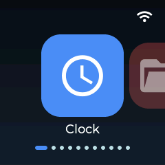
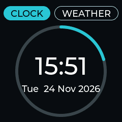
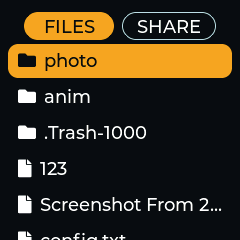
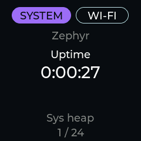
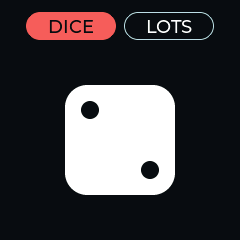
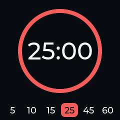
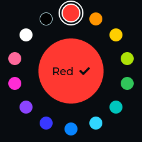
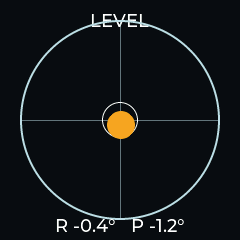
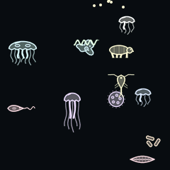

# ZephyrHoloCubic

[English](README.md) | 繁體中文

用 Zephyr RTOS 和 LVGL 做的 HoloCubic 風格小螢幕裝置：ESP32 驅動一塊 240x240 的 ST7789 螢幕，畫面透過上方的分光稜鏡觀看，另有 SD 卡、MPU6050 姿態感測器和一顆 WS2812 RGB LED。

操作透過 USB 序列埠的 shell 指令，或敲一下裝置。

細節以程式為準，這份文件只寫不容易從程式看出來的事：各模組的用法在 `app/include/*.h` 開頭的註解，指令清單用 shell 的 `help`，建置指令用 `just`。

## App

開機後是橫向輪播的 Menu。

<table>
<tr>
<td align="center"><br>Menu</td>
<td align="center"><br>Clock</td>
<td align="center"><br>Files</td>
</tr>
<tr>
<td align="center"><br>System</td>
<td align="center"><br>Dice</td>
<td align="center"><br>Timer</td>
</tr>
<tr>
<td align="center"><br>Light</td>
<td align="center"><br>Level</td>
<td align="center"><br>Aquarium</td>
</tr>
</table>

截圖是螢幕上的原始畫面，透過稜鏡看會比較暗、比較糊。重截用 `just shot`。

| App | 說明 |
|---|---|
| Clock | 網路對時的時鐘；WEATHER 分頁是目前天氣和今天的最高 / 最低溫（wttr.in） |
| Files | FILES 分頁瀏覽 SD 卡（點檔案看大小）；SHARE 分頁是網頁版的檔案管理 |
| Gallery | PHOTOS 分頁：`/photo/` 裡的相片，可自動輪播；ANIM 分頁：播放 `/anim/<名稱>/` 裡的 JPEG 序列 |
| Level | 水平儀 |
| Dice | 骰子，以及從 `/lots.txt` 抽籤 |
| Light | 用 RGB LED 當氣氛燈 |
| Timer | 計時器，翻面朝下暫停 |
| System | SYSTEM 分頁：heap、SD 卡、每個 thread 的 stack 用量；WI-FI 分頁：訊號強度、IP、附近的網路。一次顯示一項，上下換項目 |
| Cast | 把電腦上的圖片、GIF 或螢幕畫面投到方塊上 |
| Aquarium | 水母和微生物，敲一下或 OK 撒飼料 |
| Test | 空的 app，測試新功能用 |

## 硬體

| 元件 | 介面 | 腳位 |
|---|---|---|
| ESP32（PICO-D4，沒有 PSRAM） | | 板子：`esp32_devkitc/esp32/procpu` |
| ST7789V 240x240 螢幕 | SPI3（DMA） | SCLK 18、MOSI 23、DC 2、RST 4、背光 5（低電位點亮，只有開關） |
| SD 卡 | SPI2 | SCLK 14、MOSI 13、MISO 26、CS 15 |
| MPU6050 | I2C0，0x68 | SDA 32、SCL 33 |
| WS2812 RGB LED | I2S0 | DATA 27 |

腳位定義在 [app/boards/esp32_devkitc_procpu.overlay](app/boards/esp32_devkitc_procpu.overlay)。

## 編譯與燒錄

在 dev container（`.devcontainer/`，Podman）裡建置，電腦上只需要 Podman 和 VS Code（或 `devcontainer` CLI）：

- 映像檔是 Zephyr 的 `zephyr-build`，裡面有 Zephyr SDK（1.0.1）、west、just 和電腦端工具用的 Python 套件。
- 第一次啟動時照 [west.yml](west.yml) 建好 west workspace：Zephyr（固定版本，4.5 開發版）、hal_espressif 和 Wi-Fi blob。放在 named volume 裡，重建 container 也會留著。
- 啟動 container 前在電腦上把 `ZEPHYR_PORT` 設成板子的序列埠，最好用固定的 `/dev/serial/by-id/...` 路徑（ttyUSB 編號重新插拔會變）。container 會拿到這個裝置，燒錄、monitor 和測試都用它。啟動 container 時板子要插著。

```bash
just            # 列出所有指令
just build      # 編譯
just flash      # 燒錄
just monitor    # 序列埠 console（Ctrl+] 離開）
just test       # 重置後自動開關每個 app，回報錯誤和 stack 用量
just test-share # 實機測試 Files 的 SHARE 分頁（需要 Wi-Fi）
just shot clock.png "app open Clock"   # 截圖存成 PNG，後面是截圖前要送的指令
```

燒錄和測試會用到序列埠，要先關掉 monitor。序列埠是 `ZEPHYR_PORT`，臨時換埠用 `just port=/dev/ttyUSB0 flash`。

## 操作

在 `just monitor` 裡輸入指令，`help` 會列出全部，常用的：

```
app list / app open Gallery / app close
ui next / ui prev / ui ok / ui back / ui tap
ui up / ui down / ui left / ui right    app 沒用到方向時，上左等於 prev、下右等於 next
ui remote             遙控模式：方向鍵或 wasd、Enter、e（敲一下）、q（返回）、Ctrl+C 離開
wlan set SSID [PSK]   設定 Wi-Fi 並連線
wlan status / wlan scan / wlan forget
config list           所有設定
```

所有 app 的操作規則相同：**上下選擇，左右切分頁，OK 確定，敲一下是主要動作**（擲骰、撒飼料、開始計時、換燈色、下一張相片……）。方塊本身只能敲，其他都要接序列埠。敲一下在 Menu 沒有作用；app 沒處理時等於 `ui next`。

## 設定

設定存在 flash，不插 SD 卡也有效，重新燒錄不會消失。

| Key | 說明 | 沒設定時 |
|---|---|---|
| `wifi_ssid` | Wi-Fi 名稱（只支援 2.4 GHz） | 不連網路 |
| `wifi_psk` | Wi-Fi 密碼，8 到 64 個字元 | 當成開放網路 |
| `tz` | 時區，例如 `+8`、`-5`、`+5:30` | `+8` |
| `ntp_server` | 對時用的 NTP server | `pool.ntp.org` |
| `weather_location` | 城市名或 `緯度,經度` | 依 IP 判斷 |

兩種改法：

- **shell**：`config set tz +9`、`config unset tz`，Wi-Fi 用 `wlan set`。馬上生效。
- **SD 卡上的 `/config.txt`**，一行一個 `key=value`，在電腦上編輯或用 Share 上傳。這個檔只用來**匯入**：開機時和 Share 存好它的時候，認得的 key 會存進 flash 並從檔案刪掉，所以匯入後檔案會變空，密碼不留在卡上。格式不對的行會留在檔案裡，log 有 warning。

要讓方塊忘記網路用 `wlan forget`，把方塊交給別人前記得做。

## SD 卡內容

SD 卡要格式化成 FAT32。

```
/photo/*.jpg            Gallery 的相片
/anim/<名稱>/000.jpg…   每個動畫一個資料夾，編號不能缺號；選用的 delay.txt 是每格毫秒數
/lots.txt               抽籤清單，一行一項（只支援英數字）
```

圖片必須是 **baseline JPEG**，不超過 240x240。一般軟體存的 JPEG 常解不出來，先用附的工具轉檔：

```bash
just img2jpg ~/Pictures out/photo     # 轉檔後自己複製到卡上
just gif2jpg cat.gif out/cat          # GIF 轉成動畫資料夾
```

照片也可以不轉檔，直接用 Share 的網頁上傳到 `photo` 資料夾，瀏覽器會自動縮圖轉檔。

### Share

打開 Files 切到 SHARE 分頁，畫面會顯示網址和 4 位數 PIN（只有這一頁開著時才提供服務）。用瀏覽器打開網址、輸入 PIN，就能瀏覽、上傳、下載、刪除和建立資料夾。

- PIN 是固定的，在 SHARE 分頁按 OK 換一組（敲一下不會換）。連錯幾次會暫時鎖住。
- 檔名只能用英數字、空白和 `._-+()`。
- 一次只服務一個連線，速度是幾十 KB/s。
- 有 PIN 的人可以上傳 `/config.txt` 改設定，所以只在信任的網路上打開。
- 也可以用 curl：`curl -b pin=1234 -T cat.jpg http://<IP>/photo/`，其他用法見 `app/src/apps/fg/share_page.c` 開頭。

### Cast

打開 Cast，畫面會顯示位址，然後在電腦上：

```bash
just cast <IP> cat.gif
just cast <IP> ~/Pictures --hold 5
just cast <IP> --screen               # 只支援 X11
```

每秒幾格，尺寸越小越順（`--size 160x160`）。其他選項：`just cast <IP> --help`。

## 新增 app

在 `app/src/apps/fg/` 新增一個檔案，並加進 [app/src/apps/CMakeLists.txt](app/src/apps/CMakeLists.txt)：

```c
#include "fg_app.h"
#include "ui.h"

typedef struct {
    lv_obj_t *label;
    uint32_t shown;
} self_t;

// 名稱、Menu 圖示、三個 callback、在 Menu 的順序（每個 app 不同，不能是 0）、狀態的型別
APP_FG_REGISTER(Uptime, ICON_TIMER, app_uptime_init, app_uptime_run, app_uptime_exit, 20, self_t);

static void app_uptime_init(void *scr)
{
    ui_screen_init(scr);
    self->label = ui_label(scr, &lv_font_montserrat_18, THEME_TEXT);
    lv_obj_center(self->label);
    self->shown = UINT32_MAX;
}

static void app_uptime_run(void *scr)
{
    uint32_t sec = k_uptime_get_32() / 1000;
    if (sec != self->shown) {
        self->shown = sec;
        lv_label_set_text_fmt(self->label, "%u", sec);
    }
}

static void app_uptime_exit(void *scr)
{
}
```

規則：

- **`init`** 每次開啟都會呼叫，畫面是空的。**`run`** 每一幀呼叫一次，不能阻塞。**`exit`** 釋放自己配置的資源，畫面上的物件由框架刪除。LVGL 只能在這三個 callback 裡呼叫。
- **狀態放在 `self_t`**，用 `self->` 存取，不要寫成 `static`。所有前景 app 共用同一塊記憶體，`init` 之前會清成 0，`exit` 之後不能再用。放不下時 build 會失敗，再調大 `CONFIG_APP_STATE_SIZE`。只有離開 app 後還要保留的東西才用 `static`，並註明原因。
- **會等待的工作不能放在 `run`**：DNS、HTTP 這類丟到 `net_job_queue()`，app 只讀結果。只在 app 開著時需要的 server 用 `net_server.h` 的 non-blocking socket。
- **顏色用 `theme.h`**，不要寫色碼。**透過稜鏡看，小字和非白色的字都看不清楚**：要讀的文字一律 `THEME_TEXT`、至少 18 px（Montserrat 18 / 28 / 48，不要再加別的大小），顏色只用在大字、色塊和反白，小圖形也要接近白色。說明、單位這類小字寧可拿掉。
- **操作照同一套規則**：上下選擇，OK 確定，敲一下（`NAV_TAP`）做這個 app 最主要的事，方塊沒接電腦時只靠它。有好幾頁的 app 用 `ui_tabs.h`（Dice、Clock、System、Files、Gallery），左右 / next / prev 切分頁由它處理。
- **先找現成的**：`ui.h`（標籤、清單）、`nav.h`（自己處理 next / prev / ok / 敲擊）、`prefs.h`（重開機後保留的值）、`conf.h`（使用者設定）、`jpeg.h`（顯示 JPEG）、`led.h`、`file.h`。
- **圖示**：在 `tools/mkicons.py` 的清單加一行後重新執行，用法在檔案開頭。

## 專案結構

```
.devcontainer/      dev container（映像檔、west workspace 設定）
west.yml            west manifest：Zephyr 版本和模組
app/boards/         硬體與腳位（devicetree overlay）
app/prj.conf        Kconfig 設定和調整的原因
app/include/        各模組的介面和用法說明
app/src/            框架與共用模組
app/src/apps/bg/    Menu
app/src/apps/fg/    各個 app
app/src/lib/tjpgd/  TJpgDec
tools/              電腦端的工具：轉檔、投影、圖示字型、實機測試
```

## 注意事項

開發過程中踩到的問題，修改相關部分前請先看：

- **畫面鏡像**：overlay 的 `mdac = <0x40>` 是左右鏡像，給透過稜鏡觀看用。上下顛倒時的改法寫在 overlay 的註解裡。
- **只能一條 SPI 開 DMA**：兩條 SPI 共用 DMA 時脈，第二條會初始化失敗，所以只有螢幕開 DMA。
- **SD 卡的 SPI 不能超過 20 MHz**：MISO 在 GPIO 26，要經過 GPIO 矩陣。
- **I2C 維持 100 kHz**：板子上沒有外部上拉，靠 ESP32 的內建上拉（`app/src/i2c_pullup.c`）。GPIO 32/33 是 RTC pad，pinctrl 的上拉設定對它們沒有作用。
- **重置後 IMU 可能讀不到**：MPU6050 不會跟著重置，可能卡在讀取途中拉著 SDA，所以開機時先做 bus recovery。
- **不要在 `SYS_INIT` 裡繪圖**：LVGL 的 flush thread 要等所有 `SYS_INIT` 結束才啟動，在那之前繪圖會讓開機卡死。
- **RAM 很緊**：兩個 DRAM 區域各只剩幾 KB，build 最後會印出用量。heap、buffer 和 stack 的大小都是照實測調的（`app/prj.conf` 有註解，shell 的 `kernel heap` 和 `kernel thread stacks` 可以量）。大塊的 buffer 加 `__noinit` 放到 region 1；只有某個 app 開著才需要的放進它的 `self_t`。
- **只能用 HTTP**：TLS 需要的記憶體放不下。回應太大時要邊收邊解析，像 `weather.c`。
- **socket 很少**：server 主動斷線的連線會暫時佔著一個，所以 Share 盡量讓對方先斷線。
- **Wi-Fi 不省電**：省電模式會讓傳輸速度掉一半。
- **剛連上網路時 DNS 可能沒回應**：短時間內重新連線時偶爾發生，是網路端的行為，靠重試處理。`just test` 偶爾會因此出現一筆 SNTP 或 weather 的 warning。
- **LED 偶爾寫入失敗**：ws2812 driver 在只有一顆 LED 時的時序問題，`led.c` 會重送。
- **編譯器 bug**：SDK 1.0.1 的 Xtensa GCC 會把 TJpgDec 的一段迴圈編錯，解碼時當機。`app/src/lib/tjpgd/tjpgd.c` 已改寫那一段，更新 TJpgDec 時要保留。
- **`just test` 不一定會解碼 JPEG**：只有卡上有相片、而且 Gallery 開在 PHOTOS 分頁時才會。改到 JPEG 相關的程式後，要實際開 Gallery 或用 Cast 確認。截圖也截不到 JPEG，因為它是直接畫到螢幕的。
- **字型**：內建的 Montserrat 不含中文。

## 授權

`app/src/lib/tjpgd/` 是 ChaN 的 TJpgDec，授權見 [app/src/lib/tjpgd/LICENSE.txt](app/src/lib/tjpgd/LICENSE.txt)。App 圖示來自 Material Design Icons（Apache 2.0）。
